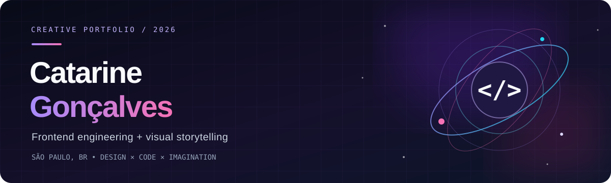

<div align="center">



<br/>

<a href="https://www.linkedin.com/in/catarinegoncalves/"></a>
<a href="https://www.twitch.tv/caaabritinho"></a>
<a href="mailto:ccatarinegoncalves@gmail.com"></a>

<br/><br/>

**Design com personalidade. Código com propósito.** ✦

*Building meaningful interfaces at the intersection of technology, art and imagination.*

</div>

---

### `01 / sobre mim`

Oi! Eu sou a **Cath**, desenvolvedora **Front-end** de São Paulo. 💜

Trabalho com aplicações web, interfaces responsivas e experiências digitais. Gosto de transformar ideias em produtos que sejam **bonitos, acessíveis e agradáveis de usar** — sem esquecer da organização e da performance do código.

Atualmente, exploro cada vez mais o universo de **Creative Development**: animações, experiências imersivas, 3D e storytelling visual.

- 🛠️ **No dia a dia:** Vue 3, Quasar, JavaScript, TypeScript e integrações com APIs.
- 🎨 **No laboratório criativo:** React, Next.js, motion, 3D e UI/UX.
- 🪐 **Meu lado autoral:** universos fictícios, identidade visual e projetos que misturam arte + tecnologia.

### `02 / minha stack`

<div align="center">


<br/><br/>


</div>

### `03 / projetos em destaque`

| Projeto | O que você vai encontrar | Tecnologias |
| :--- | :--- | :--- |
| [**🌌 The Sparks Brothers**](https://github.com/CatarineGoncalves/TheSparksBrothers) | Um universo autoral com exploração de planetas, efeitos visuais e narrativa interativa. | Next.js · React · TypeScript · Motion |
| [**✨ Portfólio criativo**](https://github.com/CatarineGoncalves/new-portifolio) | Uma experiência pessoal com estética dark, animações e uma cena 3D interativa. | React · Vite · Three.js · Tailwind |

<div align="center">

[**↗ Explorar meus repositórios**](https://github.com/CatarineGoncalves?tab=repositories)

</div>

### `04 / um pouco além do código`

```js
const cath = {
  code: ["front-end", "creative development"],
  inspirations: ["arte", "música", "design", "mundos imaginários"],
  currentlyExploring: ["motion", "3D", "interfaces memoráveis"],
  motto: "Make it work. Make it beautiful. Make it feel alive."
};
```

### `05 / vamos criar algo?`

Tem um projeto criativo, uma interface diferente ou uma ideia que parece impossível? Adoro esse tipo de desafio.

<div align="center">

<a href="https://www.linkedin.com/in/catarinegoncalves/"></a>

<br/><br/>

<sub>Feito com 💜, música alta e provavelmente CSS demais.</sub>

</div>
